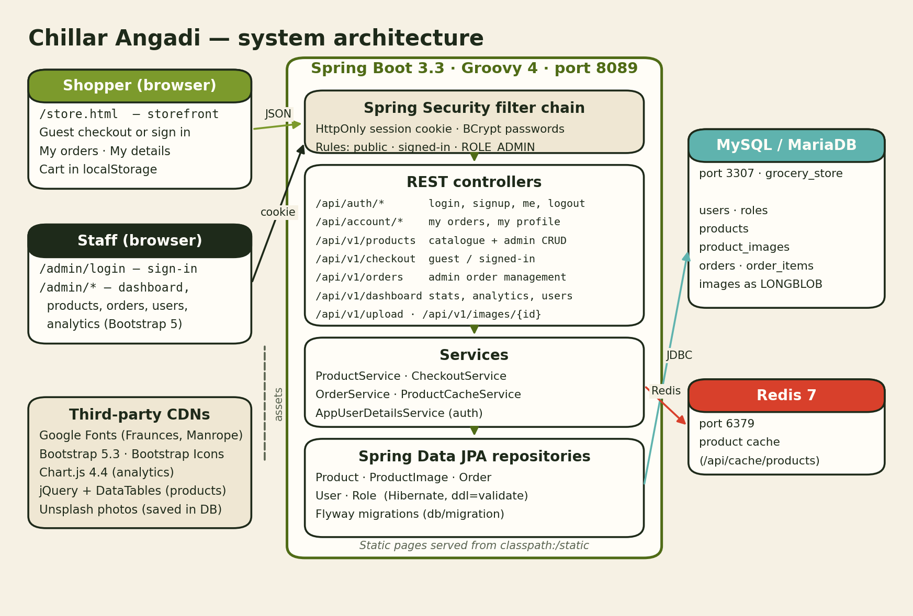
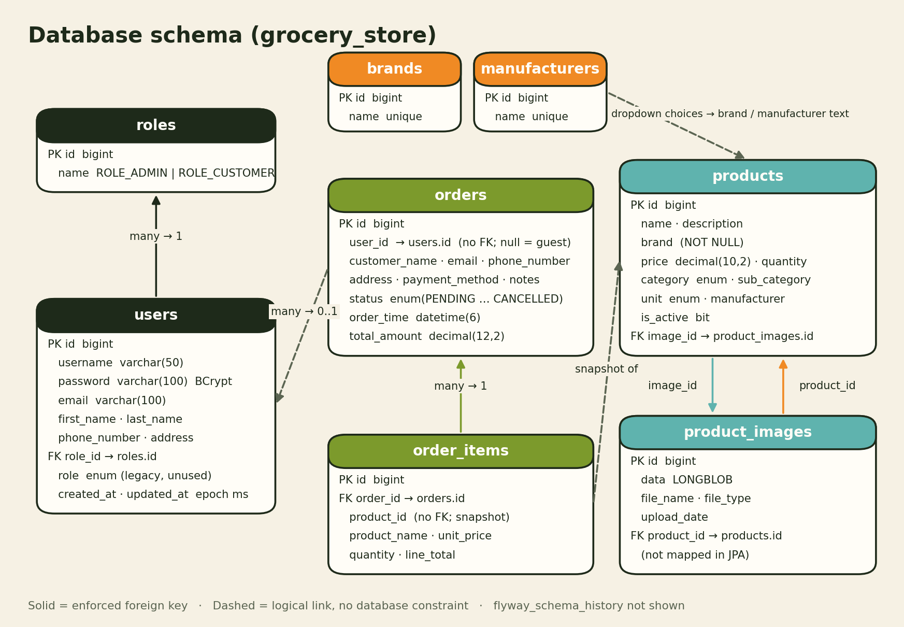

# Chillar Angadi

**Chillar Angadi** is an online neighbourhood grocery store. Shoppers browse the shelf, fill a basket and check out as a guest or with an account. Staff run the shop from a separate admin console covering stock, orders, customers and analytics.

It's a single Spring Boot service written in Groovy. The service serves the web pages and a JSON REST API, keeps data (including product photos) in MySQL/MariaDB, and caches products in Redis.

> A full technical guide (architecture, schema, features, admin access and roadmap) is generated as
> `docs/Chillar_Angadi_Technical_Guide.pdf`. It contains admin credentials, so it is **git-ignored** and only
> exists on the machine where it was generated.

---

## Contents

- [Features](#features)
- [Tech stack](#tech-stack)
- [Architecture](#architecture)
- [Database schema](#database-schema)
- [Getting started](#getting-started)
- [Admin access](#admin-access)
- [API overview](#api-overview)
- [Project layout](#project-layout)
- [Redis](#redis)
- [Future improvements](#future-improvements)

---

## Features

### Storefront (`/store.html`)
- **Landing hero:** a photo collage from the Angadi Farm range that shows a different trio on every visit and every sign-in.
- **Shelf:** category chips, a filters panel (brands, in stock only), live search (⌘K), pagination, stock bars and "only N left" labels.
- **Basket drawer:** quantity steppers capped at available stock. The basket survives page reloads.
- **Checkout:** as a **guest**, or **signed in** with name, email, phone and address pre-filled. Email and phone are validated, double submission is blocked, and the confirmation shows the order number.
- **Accounts:** create an account and sign in with email or username. **My orders** shows full history with line items; **My details** lets you edit name, phone and address.
- **Layout and safety:** responsive down to phone width, respects reduced-motion settings, and escapes product text.

### Admin console (`/admin/login`)
Staff only. The console isn't linked from the store, and customer accounts are refused.

| Page | What it does |
|---|---|
| **Dashboard** | All-time revenue, orders (pending, this month vs last), products running low or out of stock, new accounts, recent orders |
| **Products** | List, search, add, edit (with photo upload), delete. Brand and manufacturer are dropdowns with **+ Add new…**; sub-categories follow the chosen category. Deleting removes the product's photos; past orders keep their own copy of name and price |
| **Orders** | List, search by name or phone, view details, edit, change status, delete |
| **Users** | Every account with role, contact details, order count, total spent, join date and last order |
| **Analytics** | Today / 7 days / 30 days / 12 months / all time: revenue, orders, new customers and average order vs the previous period; sales over time; sales by category; top products. Cancelled orders don't count as revenue |

### Who can do what

| | Guest | Customer | Admin |
|---|:-:|:-:|:-:|
| Browse, search, place orders | ✓ | ✓ | ✓ |
| My orders / My details | — | ✓ | ✓ |
| Admin pages and admin APIs | — | — | ✓ |
| Swagger UI | — | — | ✓ |

---

## Tech stack

| Layer | Technology |
|---|---|
| Language / framework | Groovy 4.0.23 · Spring Boot 3.3.4 · Java 17 |
| Security | Spring Security 6, server-side sessions (HttpOnly, SameSite=Lax cookie, 7-day timeout), BCrypt |
| Persistence | Spring Data JPA / Hibernate (`ddl-auto=validate`) · Flyway |
| Database | MySQL 8 or MariaDB, port **3307**, database `grocery_store` |
| Cache | Redis 7, port **6379** |
| Storefront | Hand-written HTML/CSS/JS, Fraunces + Manrope fonts |
| Admin UI | Bootstrap 5.3 + `css/admin-theme.css`, Chart.js 4.4, jQuery DataTables |
| API docs | springdoc-openapi (Swagger UI) |
| Build / run | Gradle wrapper · Docker Compose |

---

## Architecture



- **Security first:** every request passes the Spring Security filter chain. The storefront, catalogue reads, product photos and checkout are public. `/api/account/**` needs a signed-in user. Everything else needs `ROLE_ADMIN`: admin pages, order management, product writes, uploads, dashboard and Swagger.
- **Unauthenticated access:** API calls get a JSON `401`/`403`. Page requests are redirected to `/admin/login?next=…`, which sends staff back to the page they wanted after signing in.
- **Sessions, not tokens:** signing in stores the security context in the HTTP session, and the session ID changes on login. Restarting the app signs everyone out.
- **Missing paths** return `404` (not `500`).

---

## Database schema



| Table | Notes |
|---|---|
| `users` | Login by username or email; BCrypt password; role from `role_id` (the old `role` enum column is unused) |
| `roles` | `1 = ROLE_CUSTOMER`, `2 = ROLE_ADMIN` |
| `products` | Prices in ₹; `brand` is **NOT NULL** in the database; `image_id` points at the current photo |
| `product_images` | Photos stored as `LONGBLOB`, served at `/api/v1/images/{id}`. Its `product_id` FK isn't mapped in JPA; product delete clears it with native SQL |
| `orders` | Copies the customer's details at order time; `user_id` is set for signed-in orders and `NULL` for guests (no FK) |
| `order_items` | Snapshot of product name and price, so history survives product edits and deletes (no FK to products on purpose) |
| `brands`, `manufacturers` | Choices for the product form's dropdowns (Flyway V3). Products store the chosen name as text |

Schema changes go through Flyway (`src/main/resources/db/migration`); Hibernate only validates.

One-off data fixes live in `docs/data-fixes/`, each with an undo script. On 2026-10-29 every product got a correct category and sub-category, and empty brands and manufacturers were filled in.

---

## Getting started

### Prerequisites
- Java 17+
- Docker (for MySQL/MariaDB and Redis), or local installs of both

### Option A: everything in Docker

```bash
docker compose up -d
```

Then open http://localhost:8089/store.html. See [DOCKER.md](DOCKER.md) and `./docker.sh help` for more.

### Option B: run the app with Gradle

1. Start a MySQL/MariaDB on port **3307** with a database `grocery_store`, and Redis on **6379**.
2. Check the connection settings in `src/main/resources/application.properties`.
3. Run:

```bash
./gradlew bootRun
```

The app starts on **8089**. If that port is taken (on the current dev machine it's used by phpMyAdmin), override it:

```bash
./gradlew bootRun --args='--server.port=8095 --cors.allowed-origins=http://localhost:8095'
```

### Useful URLs

| URL | What |
|---|---|
| `/store.html` | Storefront (`/` redirects here) |
| `/admin/login` | Admin sign-in |
| `/admin/index.html` | Admin dashboard |
| `/swagger-ui.html` | API docs (admin only) |
| `/api-docs` | OpenAPI JSON (admin only) |
| `/actuator/health` | Health check (public) |

---

## Admin access

- **Sign-in page:** `/admin/login`
- **Admin account:** `angadi.admin`. Its password is in `ADMIN_CREDENTIALS.local.txt` and in the technical guide PDF; both files are git-ignored and never committed.
- **Original `admin` account:** still exists, but only its hash is stored, so the original password can't be recovered.

**Reset an admin password** (prompts without echoing):

```bash
read -s "PW?New admin password: "; echo; HASH=$(htpasswd -nbBC 10 "" "$PW" | tr -d ':\n'); docker exec mariadb mariadb -uroot -ppassword123 grocery_store -e "update users set password='$HASH' where username='angadi.admin';"; unset PW HASH
```

**Make someone an admin:** sign them up on the storefront, then promote the account (`role_id` 2 = `ROLE_ADMIN`):

```bash
docker exec mariadb mariadb -uroot -ppassword123 grocery_store -e "update users set role_id=2 where email='person@example.com';"
```

> The commands assume the database runs in a container named `mariadb` with the credentials from
> `application.properties`. Adjust the container name and credentials for your setup.

---

## API overview

All endpoints return JSON; errors look like `{"message": "…"}`.

| Method | Path | Access | Purpose |
|---|---|---|---|
| POST | `/api/auth/login` | Public | Sign in (username or email); `admin: true` rejects non-admins |
| POST | `/api/auth/signup` | Public | Create a customer account and sign in |
| GET | `/api/auth/me` | Public | Current user, or 401 |
| POST | `/api/auth/logout` | Public | End the session |
| GET | `/api/account/orders` | Signed in | My order history |
| PUT | `/api/account/profile` | Signed in | Update name, phone, address |
| GET | `/api/v1/products` | Public | Paged list; `name`, `categories`, `brands`, `inStockOnly` |
| GET | `/api/v1/products/{id}` | Public | One product |
| GET | `/api/v1/products/brands` | Public | Distinct brands |
| POST / PUT / DELETE | `/api/v1/products[/{id}]` | Admin | Manage products (`brand` is required) |
| POST | `/api/v1/upload` | Admin | Upload a product photo |
| GET | `/api/v1/images/{id}` | Public | Photo bytes |
| GET | `/api/v1/enums/*` | Public | Categories, sub-categories, units, brands, manufacturers |
| POST | `/api/v1/enums/brands`, `/api/v1/enums/manufacturers` | Admin | Add a dropdown choice |
| POST | `/api/v1/checkout` | Public | Place an order (guest or signed in) |
| GET / POST / PUT / DELETE | `/api/v1/orders[/{id}]` | Admin | Manage orders; `PUT /{id}/status` |
| GET | `/api/v1/dashboard/stats` | Admin | Dashboard numbers |
| GET | `/api/v1/dashboard/analytics?range=` | Admin | `today`, `week`, `month`, `year`, `all` |
| GET | `/api/v1/dashboard/users` | Admin | Accounts with order counts and spend |
| GET / POST | `/api/cache/products/{id}` | Admin | Redis product cache |

---

## Project layout

```
src/main/groovy/com/grocerystore/grocery_store/
├── controller/    REST endpoints (Auth, Account, Product, Checkout, Order, Dashboard, FileUpload, Enum, Cache)
├── security/      SecurityConfig (access rules, 401/redirects), AppUserDetailsService
├── service/       ProductService, CheckoutService, OrderService, ProductCacheService
├── repository/    Spring Data repositories
├── model/ dto/    JPA entities, enums, response DTOs
└── exception/     GlobalExceptionHandler (400/404/500 as JSON)

src/main/resources/
├── static/store.html      Storefront
├── static/admin/          login, index (dashboard), products, orders, users, data-dashboard (analytics)
├── static/css/            admin-theme.css
├── static/js/             admin-session.js (admin guard + sign-out)
└── db/migration/          Flyway migrations

docs/diagrams/             architecture.png, er-diagram.png
docs/data-fixes/           One-off SQL data fixes (+ undo scripts)
PHOTO_CREDITS.md           Unsplash photo credits
```

---

## Redis

```bash
docker exec -it redis-maintenance redis-cli   # or the name of your Redis container
KEYS *
GET product:1
```

[RedisInsight](https://redis.com/redis-enterprise/redis-insight/) also works: connect to `localhost:6379`.

---

## Future improvements

**Before launch**
- Move secrets out of `application.properties` (environment variables or a secrets store).
- Serve over HTTPS and mark the session cookie `Secure`; re-enable CSRF protection.
- Rate-limit sign-in attempts; add email verification and password reset.
- Prevent overselling under concurrent checkouts (optimistic locking or `SELECT … FOR UPDATE`).
- Integrate a real payment gateway. UPI, cards and net banking are labels only today.

**Next**
- Faster, typo-tolerant product search (today it's a simple name match in the database).
- Order notifications (email/SMS) and customer-side cancellation.
- Move photos from `LONGBLOB` to object storage + CDN; map or drop `product_images.product_id`.
- Admin user management (promote, disable, reset) and an audit log.
- API, security and checkout tests, run in CI.

**Later**
- Analytics in SQL instead of in memory, delivery slots, saved addresses, coupons, bulk CSV import/export, and removing leftovers (unused JWT config, legacy `users.role`, `js/auth.js`, demo filter endpoints).
